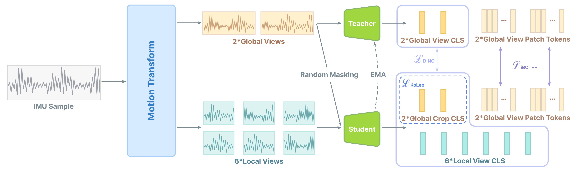
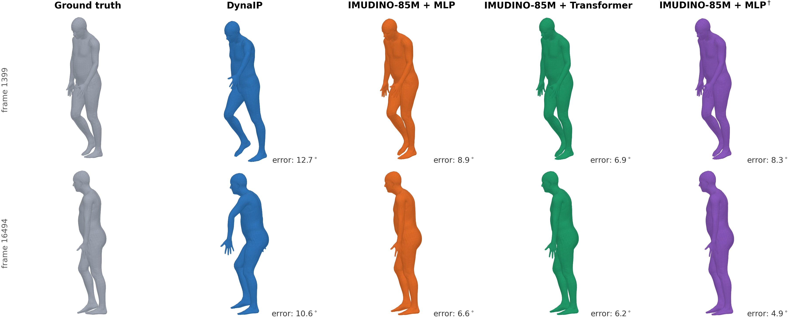

<div align="center">

# IMUDINO: Self-distilled Foundation Model for Inertial Sensing

**Zhoutong Ye**<sup>1‡</sup> ·
**Chengwen Zhang**<sup>1*</sup> ·
**Zixuan Wang**<sup>1*</sup> ·
**Xufeng Jian**<sup>1*</sup> ·
**Zhe He**<sup>1</sup> ·
**Qingyang Wan**<sup>1</sup> ·
**Xutong Wang**<sup>1</sup> ·
**Jiaqi Liu**<sup>1</sup> ·
**Mingze Sun**<sup>1</sup> ·
**Yu Mei**<sup>1</sup> ·
**Chun Yu**<sup>1†</sup> ·
**Yuanchun Shi**<sup>1</sup>

<sup>1</sup> Tsinghua University&nbsp;&nbsp;·&nbsp;&nbsp;<sup>†</sup> Corresponding Author&nbsp;&nbsp;·&nbsp;&nbsp;<sup>‡</sup> Project Leader&nbsp;&nbsp;·&nbsp;&nbsp;<sup>*</sup> Equal Contribution

[](https://huggingface.co/Octopus1/IMUDINO)
[](http://arxiv.org/abs/2611.07437)

</div>

Official PyTorch release of IMUDINO, a general purpose foundation model for inertial sensing.
See the [paper](http://arxiv.org/abs/2611.07437) for details.

## Method overview



*Overview of the IMUDINO training objective (Figure 1 in the paper): semantics-preserving motion
transformations produce global and local views, which are distilled from an EMA teacher to a
student with DINO, iBOT++, and KoLeo objectives.*

## Results

Main results on seven HAR datasets (Table 1 in the paper). Bold marks the best result;
$^*$implemented with IMUDINO data augmentation.

| Type | Method | MoSense | HAPT | HHAR | DSADS | WEAR | OPPO. | Shoaib | Average |
| --- | --- | --- | --- | --- | --- | --- | --- | --- | --- |
| Supervised Baselines | DeepConvLSTM | 93.39 | 82.00 | 91.90 | 83.25 | 75.43 | 40.88 | 97.13 | 80.57 |
| | A&D | 95.79 | 81.95 | 94.17 | 86.12 | 77.10 | 46.29 | 97.79 | 82.74 |
| | IF-ConvT. | 95.81 | 85.35 | 95.01 | 88.82 | N/A | 50.29 | 98.28 | 85.59 |
| | TSF | 97.34 | 85.89 | 95.81 | 89.70 | N/A | 52.44 | 99.35 | 86.76 |
| Self-supervised HAR FMs | SimCLR$^*$ | 96.08 | 80.56 | 87.56 | 91.56 | 88.48 | 43.50 | 99.29 | 83.86 |
| | Yuan et al. | 93.41 | 64.66 | 80.41 | 83.37 | 83.10 | 18.28 | 97.30 | 74.36 |
| | RelCon | 81.93 | 55.75 | 70.57 | 81.04 | 81.55 | 19.80 | 97.32 | 69.64 |
| | HAR-FM | 84.93 | 71.41 | 76.47 | 84.93 | 80.01 | 20.24 | 97.67 | 73.20 |
| General-purpose TSFMs | TimesFM 3.0 | 85.64 | 63.30 | 82.97 | 75.09 | 78.92 | 33.50 | 93.61 | 73.29 |
| | Chronos-2 | 83.95 | 57.04 | 72.60 | 73.04 | 62.93 | 24.65 | 90.71 | 66.36 |
| IMUDINO (Ours) | IMUDINO-6M | 97.91 | 87.56 | 95.33 | 93.24 | 91.28 | 53.54 | 99.58 | 88.35 |
| | **IMUDINO-85M** | **98.54** | **89.02** | **96.00** | **94.13** | **92.34** | **58.40** | **99.68** | **89.73** |

Qualitative comparison of inertial human pose estimation on a natural motion sequence
(Virginia Natural Motion; Figure 4 in the paper):



*From left to right: ground truth, DynaIP, and IMUDINO-85M with an MLP probe, a transformer
probe, and an MLP probe with finetuned backbone. Numbers below each mesh denote the per-frame
mean root-aligned global rotation error in degrees.*

## Download the checkpoint

The weights are hosted on Hugging Face: [Octopus1/IMUDINO](https://huggingface.co/Octopus1/IMUDINO).
Download `imudino.pt` into this repository's root directory:

```bash
# huggingface-cli (pip install "huggingface_hub[cli]")
huggingface-cli download Octopus1/IMUDINO imudino.pt --local-dir .

# or plain download
wget https://huggingface.co/Octopus1/IMUDINO/resolve/main/imudino.pt
```

The example scripts expect `imudino.pt` next to them by default.

The backbone uses 16-sample patches, 12 transformer layers, 24 attention heads,
768-dimensional features, and 4 register tokens. It embeds all six sensor channels
jointly and uses standard GELU MLPs. Frequency-aware positional encoding always
uses the supplied sampling rates and a fixed 100 Hz reference. The factory retains
its original name, `imuformer_huge_patch16`, for compatibility.
The implementation lives in `imudino.py`; constructing `IMUFormer()` directly
uses the same settings as the factory.

Install PyTorch and timm in a Python 3.10+ environment:

```bash
pip install -r requirements.txt
python example_forward.py
```

Use `--device cuda` for a CUDA device or `--checkpoint /path/to/imudino.pt` for a
different checkpoint location. The example loads weights strictly, switches to
evaluation mode, and runs inference on a synthetic batch with padding. Tested
with Python 3.12, PyTorch 2.15.0, and timm 1.0.30.

To use the model in your own code:

```python
import torch
from model_factory import imuformer_huge_patch16

model = imuformer_huge_patch16()
model.load_state_dict(
    torch.load("imudino.pt", map_location="cpu", weights_only=True), strict=True
)
model.eval()

with torch.inference_mode():
    features = model({
        "imu_data": torch.randn(2, 1024, 6),
        "freqs": torch.tensor([100.0, 200.0]),
        "masks": None,
    })
```

Input `imu_data` has shape `[B, L, 6]`, with accelerometer XYZ followed by gyroscope
XYZ. `L` must be a positive multiple of 16. `freqs` contains one positive sampling
frequency in Hz per sequence. Use floating-point inputs on the same device as the
model.

The optional `masks` tensor has shape `[B, L]`: `True`/`1` means valid and
`False`/`0` means padding. A patch is valid only when all 16 samples are valid.
Omit `masks` or pass `None` for unpadded input. Padded patches remain in the output;
exclude them when pooling or using patch features downstream.

The output contains only the final transformer layer's tokens after layer normalization:

| Key | Shape | Description |
| --- | --- | --- |
| `cls_token` | `[B, 768]` | Sequence representation |
| `reg_tokens` | `[B, 4, 768]` | Register representations |
| `patch_tokens` | `[B, L / 16, 768]` | Temporal patch representations |

For the example batch, these shapes are `(2, 768)`, `(2, 4, 768)`, and `(2, 64, 768)`.
